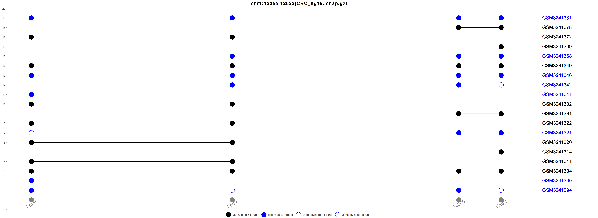
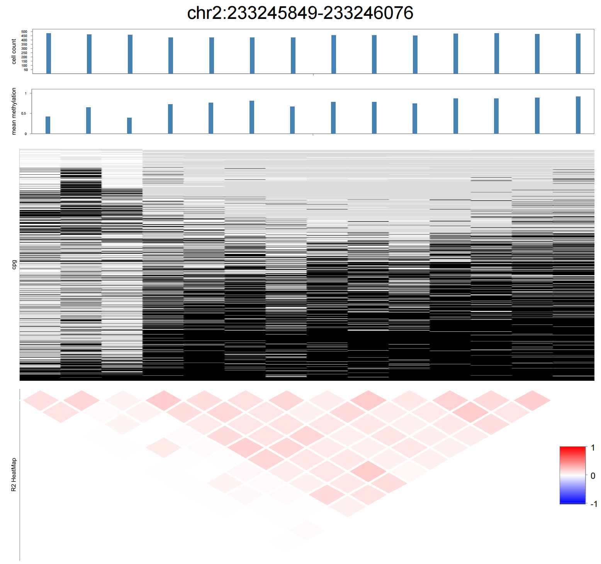

***

# Abstract
Bisulfite sequencing (BS-seq) remains the gold standard technique to detect DNA methylation profiles at single-nucleotide resolution. 
The DNA methylation status of CpG sites on the same fragment represents a discrete methylation haplotype (mHap). 
The mHap-level metrics were demonstrated to be promising cancer biomarkers and explain more gene expression variation than average methylation. 
However, most existing tools focus on average methylation and neglect mHap patterns. 
Previously, we have developped [mHapTk](https://github.com/CCCKW/mHapTk), a comprehensive toolkit for the analysis of DNA methylation haplotypes
and [mHapSuite](https://github.com/yoyoong/mHapSuite) a Java toolkit for the analysis of bulk mHaps.
Here, we present mHapSc, a Java toolkit for the analysis of single-cell mHaps.

# Installation
It is written in Java, and should run in Windows, Linux and macOS with java 1.8 installed. 
source code of mHapSc is hosted in [github](https://github.com/yoyoong/mHapSc) and the jar file is ready to use.

# Main functions
mHapSc is a Java toolkit for the analysis of single-cell DNA methylation haplotypes. 
It has 9 sub-commands: convert, tanghulu, R2, MHBDiscovery, hemiM, track, flinkage, stat and scStat.

```
mHapSc: a Java toolkit for the analysis of single-cell DNA methylation haplotypes
Usage: java -jar mHapSuite <command> [options]

Commands:
    convert         convert raw sequencing file to mHap file
    tanghulu        visualize the methylation status of the reads that cover a given region.
    R2              show linkage disequilibrium (LD) R2 scores of CpGs in a region
    MHBDiscovery    identification of methylation haplotype blocks within a region or genome-wide
    hemiM           discovery and statistics the hemi-methylation CpG sites
    track           calculate DNA methylation metrics for mHaps that cover each CpG site across the genome
    flinkage        calculates the linkage disequilibrium correlation of two remote regions
    stat            calculate the methylation statistics in a single region or multiple regions
    scStat          calculate the average methylation level in a single region or multiple regions
```

## convert
Convert Single-cell methylation sequencing file or nanopore methylation sequencing file or allc methylation 
sequencing file to mHap format file. Single-cell methylation sequencing file was introduced in [scMethBank-Documentation](https://ngdc.cncb.ac.cn/methbank/scm/documentation#data).
Nanopore methylation sequencing file was introduced in [Simpson JT et al., 2017](https://pubmed.ncbi.nlm.nih.gov/28218898/).
Allc methylation sequencing file was introduced in [Chongyuan Luo et al., 2017](https://pubmed.ncbi.nlm.nih.gov/28798132/).
MHap format file was introduced in [Zhiqiang Zhang et al., 2021](https://pubmed.ncbi.nlm.nih.gov/34179956/).
We use the extended mhap format file, that is, add a barcode column in the last column.
```Shell
usage: java -jar mHapSc-1.0-jar-with-dependencies.jar convert --inputPath <in.bed/.gz> --cpgPath <CpG.gz> [--region chr:start-end] --outputDir <outputDir> --tag <tag> [--nanopolish] [--allc]
Options:
 -inputPath,--inputPath <args>   input file, Single-cell methylation sequencing file is bed.gz format, Nanopore methylation sequencin is tsv.gz format
 -cpgPath,--cpgPath <args>       genomic CpG file, gz format and indexed
 -region,--region <args>         one region, in the format of chr:start-end
 -outputDir,--outputDir <args>   output directory, created in advance
 -tag,--tag <args>               prefix of the output file(s) [convert.out]
 -nanopolish,--nanopolish        indicates whether input file is nanopore methylation sequencing file
 -allcFlag,--allcFlag            whether inputPath is allc methylation sequencing file
 ```
Single-cell methylation sequencing file example:
```
chr1	G	3000851	CHH	CC	0.1	1	10
chr1	C	3001624	CHG	CA	0.0	0	9
chr1	C	3001631	CG	CG	1.0	5	5
chr1	G	3001632	CG	CG	0.9	9	10
```
Example of Single-cell methylation sequencing file:
```Shell
java -jar mHapSc-1.0-jar-with-dependencies.jar convert -inputPath example.bed -cpgPath hg19_CpG.gz -outputDir outputDir -tag test
```
Nanopore methylation sequencing file example:
```
chromosome	strand	start	end	read_name	log_lik_ratio	log_lik_methylated	log_lik_unmethylated	num_calling_strands	num_motifs	motif	sequence
chr1	+	67272185	67272185	3cb639f1-c56d-47e6-ac37-881dd0909f61	11.40	-149.50	-160.91	1	1	GC	TTAGMTAG
chr1	+	67272233	67272233	3cb639f1-c56d-47e6-ac37-881dd0909f61	14.81	-135.37	-150.18	1	1	GC	AATGMTAT
chr1	+	67272257	67272261	3cb639f1-c56d-47e6-ac37-881dd0909f61	-10.83	-125.52	-114.69	1	2	GC	CTAGMCTGMTAA
chr1	+	67272279	67272279	3cb639f1-c56d-47e6-ac37-881dd0909f61	-5.39	-135.93	-130.54	1	1	GC	GAAGMTGT
```
Example of Nanopore methylation sequencing file:
```Shell
java -jar mHapSc-1.0-jar-with-dependencies.jar convert -inputPath example.tsv.gz -cpgPath hg19_CpG.gz -outputDir outputDir -tag nanopolish_test -nanopolish
```
Allc methylation sequencing file example:
```
chr1	10040	+	CCC	1	1	1
chr1	10041	+	CCT	2	2	1
chr1	10042	+	CTA	2	2	1
chr1	10046	+	CCC	2	2	1
```
Example of Allc methylation sequencing file:
```Shell
java -jar mHapSc-1.0-jar-with-dependencies.jar convert -inputPath example.txt.gz -cpgPath hg19_CpG.gz -outputDir outputDir -tag nanopolish_test -allc
```
Output mhap file example:
```
chr1	12355	12558	11111	1	+	GSM2697589
chr1	12754	12807	111111	1	+	GSM2697589
chr1	13079	13079	0	1	+	GSM2697589
chr1	14653	14775	11111111	1	-	GSM2697589
chr1	14653	15045	1111111111111111	1	+	GSM2697589
```

## tanghulu
Visualize the methylation status of the reads that cover a given region.
Tanghulu plot was originally introduced in [CGmapTools](https://cgmaptools.github.io/).
Compared to bulk tanghulu plot, single-celled tanghulu plot adds barcode information, 
and reads from the same cell and the same parent are located on the same line.
```Shell
usage: java -jar mHapSc-1.0-jar-with-dependencies.jar tanghulu --mhapPath <mhap.gz> --cpgPath <CpG.gz> [--bcFile <bcFile>] --region chr:start-end --outputDir <outputDir> --tag <tag> [--outcut outcut]
Options:
 -mhapPath,--mhapPath <args>     input file,mhap.gz format,generated by mHapTools and indexed
 -cpgPath,--cpgPath <args>       genomic CpG file, gz format and indexed
 -bcFile,--bcFile <args>         barcode file, .txt format, one barcode per line
 -region,--region <args>         one region, in the format of chr:start-end
 -outputDir,--outputDir <args>   output directory, created in advance
 -tag,--tag <args>               prefix of the output file(s) [tanghulu.out]
 -outcut,--outcut <args>         outcut
 ```
Example of usage:
```Shell
tanghulu -mhapPath CRC_hg19.mhap.gz -cpgPath hg19_CpG.gz -region chr1:12355-12522 -outputDir outputDir -tag CRC_hg19 -bcFile Methy_barcode.txt 
```
Output example:



## R2
The co-methylation level of pairwise CpGs are measure by linkage disequilibrium r-squared, caculated from individual 
reads rather than mean methylation. This tool calculates the R2 scores between pairs of CpG sites in a given region, 
in custom format or longrange format. It can also plot the CpG linkage, which is similar to the [Haploview plot](https://www.broadinstitute.org/screenshots).
```Shell
usage: java -jar mHapSc-1.0-jar-with-dependencies.jar R2 --mhapPath <mhap.gz> --cpgPath <CpG.gz> --region chr:start-end [--bcFile <bcFile>] --outputDir <outputDir> --tag <tag> [--mhapView] [--strand strand] [--longrange] [--bedFile <bedFile>]
Options:
 -mhapPath,--mhapPath <args>     input file,mhap.gz format,generated by mHapTools and indexed
 -cpgPath,--cpgPath <args>       genomic CpG file, gz format and indexed
 -bcFile,--bcFile <args>         barcode file, .txt format, one barcode per line
 -region,--region <args>         one region, in the format of chr:start-end
 -outputDir,--outputDir <args>   output directory, created in advance
 -tag,--tag <args>               prefix of the output file(s) [R2.out]
 -mhapView,--mhapView            indicates whether draw the mhapView plot [false]
 -strand,--strand <args>         strand information, one of plus, minus and both [both]
 -longrange,--longrange          indicates whether generate a file in longrange format [false]
 -bedFile,--bedFile <args>       a bed file
 ```
Example of usage:
```Shell
R2 -mhapPath CRC_hg19.mhap.gz -cpgPath hg19_CpG.gz -region chr2:233245849-233246076 -outputDir outputDir -tag CRC_hg19 -longrange -mhapView 
```
Output R2 file example in custom format:
```
chr	posi	posj	N00	N01	N10	N11	r2	pvalue
chr2	233245886	233245891	157	219	11	165	0.12931439	1.5415462198400566E-5
chr2	233245886	233245903	286	76	72	88	0.11407767	1.9633005962542627E-7
chr2	233245886	233245981	43	145	17	73	0.00205263	0.3914147238004401
chr2	233245886	233246000	44	131	16	72	0.00612663	0.3042682053323967
chr2	233245886	233246013	25	147	18	69	-0.00610308	0.7102497710209725
```
Or in longrange format:
```
chr2	233245886	233245887	chr2:233245891-233245892,0.12931439
chr2	233245886	233245887	chr2:233245903-233245904,0.11407767
chr2	233245886	233245887	chr2:233245981-233245982,0.00205263
chr2	233245886	233245887	chr2:233246000-233246001,0.00612663
chr2	233245886	233245887	chr2:233246013-233246014,-0.00610308
```
Output mhapView plot:



## MHBDiscovery
DNA methylation of adjacent CpG sites can be co-methylated and forms methylation haplotype blocks (MHBs).
It was original introduced in [S. Guo et al., 2017](https://pubmed.ncbi.nlm.nih.gov/28263317/).
```Shell
usage: java -jar mHapSc-1.0-jar-with-dependencies.jar MHBDiscovery --mhapPath <mhap.gz> --cpgPath <CpG.gz> [--bcFile <bcFile>] [--region chr:start-end] [--bedFile <in.bed>] -outputDir outputDir --tag <tag> [--window window] [--r2 r2] [--pvalue pvalue] [--qc]
Options:
 -mhapPath,--mhapPath <args>      input file,mhap.gz format,generated by mHapTools and indexed
 -cpgPath,--cpgPath <args>        genomic CpG file, gz format and indexed
 -bcFile,--bcFile <args>          barcode file, .txt format, one barcode per line
 -region,--region <args>          one region, in the format of chr:start-end
 -bedFile,--bedFile <args>        a bed file, bed format, one query region per line
 -outputDir,--outputDir <args>    output directory, created in advance
 -tag,--tag <args>                prefix of the output file(s) [MHBDiscovery.out]
 -window,--window <args>          size of core window
 -r2,--r2 <args>                  R square cutoff
 -pvalue,--pvalue <args>          P value cutoff
 -qc,--qc                         indicates whether output matrics for QC [false]
 ```
Example of usage:
```Shell
java -jar mHapSc-1.0-jar-with-dependencies.jar MHBDiscovery -mhapPath CRC_hg19.mhap.gz -region chr1:3229375-3230473 -cpgPath hg19_CpG.gz -window 5 -r2 0.5 -pvalue 0.05 -outputDir outputDir -tag CRC_hg19_MHB -qc 
```
Output file example:
```
chr1	10562	10813
chr1	10857	10887
chr1	564470	564600
chr1	566286	566317
chr1	566458	566522
```

## hemiM
Discovery and statistics the hemi-methylation CpG sites which is methylated on one read and unmethylated on the other read.
```Shell
usage: java -jar mHapSc-1.0-jar-with-dependencies.jar hemiM --mhapPath <mhap.gz> --cpgPath <CpG.gz> [--bcFile <bcFile>] [--region chr:start-end] [--bedFile <in.bed>] -outputDir outputDir --tag <tag>
Options:
 -mhapPath,--mhapPath <args>      input file,mhap.gz format,generated by mHapTools and indexed
 -cpgPath,--cpgPath <args>        genomic CpG file, gz format and indexed
 -bcFile,--bcFile <args>          barcode file, .txt format, one barcode per line
 -region,--region <args>          one region, in the format of chr:start-end
 -bedFile,--bedFile <args>        a bed file, bed format, one query region per line
 -outputDir,--outputDir <args>    output directory, created in advance
 -tag,--tag <args>                prefix of the output file(s) [hemiM.out]
 -stat,--stat                     whether stat the hemiM count of barcodes [false]
 ```
Example of usage:
```Shell
java -jar mHapSc-1.0-jar-with-dependencies.jar hemiM -mhapPath CRC_hg19.mhap.gz -cpgPath hg19_CpG.gz -bedFile CRC_MHB_non_NC.bed -bcFile CRC_LN.txt -outputDir outputDir -tag test
```
Output hemi-methylation CpG sites file example:
```
chr1	61922	0	+	GSM3241294
chr1	61922	1	-	GSM3241294
chr1	135252	0	+	GSM3241294
chr1	135252	1	-	GSM3241294
chr1	136895	0	+	GSM3241294
chr1	136895	1	-	GSM3241294
```
Output statistics file:
```
chrom	pos	GSM3241381	GSM3241378	GSM3241372	GSM3241369	GSM3241368	GSM3241349	GSM3241346	GSM3241342	GSM3241341	GSM3241332	total
chr1	87723	2	0	0	0	0	0	0	0	0	0	1
chr1	88696	0	0	0	0	0	0	2	0	0	0	1
chr1	101509	0	0	0	0	0	0	0	0	2	0	1
```

## track
Calcuate mHap-level metrics for all reads that cover each individual CpG sites in a genome-wide manner and save the results as bedGraph files.
```Shell
usage: java -jar mHapSc-1.0-jar-with-dependencies.jar track --metrics <metrics> --mhapPath <mhap.gz> --cpgPath <CpG.gz> [--bcFile <bcFile>] [--region chr:start-end] [--bedFile <in.bed>] --outputDir <outputDir> --tag <tag>
Options:
 -metrics,--metrics <args>       mHap-level metrics,including MM and R2
 -mhapPath,--mhapPath <args>     input file,mhap.gz format,generated by mHapTools and indexed
 -cpgPath,--cpgPath <args>       genomic CpG file, gz format and indexed
 -bcFile,--bcFile <args>         barcode file, .txt format, one barcode per line
 -region,--region <args>         one region, in the format of chr:start-end
 -bedFile,--bedFile <args>       a bed file, bed format, one query region per line
 -outputDir,--outputDir <args>   output directory, created in advance
 -tag,--tag <args>               prefix of the output file(s) [track.out]
 ```
Example of usage:
```Shell
java -jar mHapSc-1.0-jar-with-dependencies.jar track -mhapPath CRC_hg19.mhap.gz -cpgPath hg19_CpG.gz -region chr1:3229375-13230473 -outputDir outputDir -tag test outputDir -tag test -bcFile CRC_LN.txt -metrics MM R2 
```
Output bedGraph file example (MM):
```
chr1	3229448	3229449	0.83516484
chr1	3229470	3229471	0.943609
chr1	3229476	3229477	0.93448275
chr1	3229488	3229489	0.877551
chr1	3229501	3229502	0.86513156
```

## flinkage
Based on the concept of linkage disequilibrium, this command can get the correlation between two regions.
The output information including the position information of the regions, the number of CpG sites contained in each, 
the number of CpG sites combinations, and the number of combinations that match R2 greater than 0.5 and Pvalue less than 0.05.
```Shell
usage: java -jar mHapSc-1.0-jar-with-dependencies.jar flinkage --mhapPath <mhap.gz> --cpgPath <CpG.gz> [--bcFile <bcFile>] [--region1 chr:start-end] [--region2 chr:start-end] [--bedFile <in.bed>] --outputDir <outputDir> --tag <tag> [--limit limit] [--r2Cov r2Cov]
Options:
 -mhapPath,--mhapPath <args>     input file,mhap.gz format,generated by mHapTools and indexed
 -cpgPath,--cpgPath <args>       genomic CpG file, gz format and indexed
 -bcFile,--bcFile <args>         barcode file, .txt format, one barcode per line
 -region1,--region <args>        the first region, in the format of chr:start-end
 -region2,--region <args>        the second region, in the format of chr:start-end
 -bedFile,--bedFile <args>       a bed file, bed format, one query region per line
 -outputDir,--outputDir <args>   output directory, created in advance
 -tag,--tag <args>               prefix of the output file(s) [flinkage.out]
 -metrics,--metrics <args>       mHap-level metrics,including MM and R2
 -limit,--limit <args>           the max length to calculate [20000000]
 -r2Cov,--r2Cov <args>           minimal number of reads that cover two CpGs for R2 calculation [5]
 ```
Example of usage:
```Shell
java -jar mHapSc-1.0-jar-with-dependencies.jar flinkage -mhapPath CRC_hg19.mhap.gz -cpgPath hg19_CpG.gz -region1 chr1:949817-949850 -region2 chr1:969429-969458 -bcFile CRC_LN.txt -outputDir outputDir -tag flinkage -limit 20000000 -r2Cov 5
```
Output example:
```
chr1	10580	10813	chr1:1064217-1064339	48	5	240	12
chr1	10580	10813	chr1:4716189-4716200	48	4	192	1
chr1	10580	10813	chr1:6508784-6508836	48	7	336	4
chr1	10580	10813	chr1:9378060-9378176	48	5	240	1
```

## stat
Calculate the methylation statistics in a single region or multiple regions. 
When calculating a single interval, the --region parameter should be defined. 
If there are multiple intervals, a BED file needs to be specified.

```Shell
usage: java -jar mHapSc-1.0-jar-with-dependencies.jar stat --mhapPath <mhap.gz> --cpgPath <CpG.gz> [--bcFile <bcFile>] [--region chr:start-end] [--bedFile <in.bed>] [--strand <strand>] --tag <tag> --metrics <metrics> [--K K] [--minK minK] [--maxK maxK] [--r2Cov r2Cov]
Options:
 -mhapPath,--mhapPath <arg>   input file, mhap.gz format,generated by mHapTools and indexed
 -cpgPath,--cpgPath <arg>     strand information, one of plus, minus and both [both], gz format and indexed
 -bcFile,--bcFile <arg>       a barcode file, txt format, one barcode ID per line
 -region,--region <arg>       one region, in the format of chr:start-end
 -bedFile,--bedFile <arg>     a bed file, bed format, one query region per line
 -strand,--strand <arg>       strand type, should be plus,minus or both [both]
 -tag,--tag <arg>             prefix of the output file(s) [stat.out]
 -metrics,--metrics <arg>     mHap-level metrics,including MM,PDR,CHALM,MHL,MCR,MBS,Entropy,and R2
 -K,--K <arg>                 k-mer length for entropy, PDR, and CHALM, can be 3, 4, or 5 [4]
 -maxK,--maxK <arg>           maximum k-mer length for MHL [10]
 -minK,--minK <arg>           minimum k-mer length for MHL [1]
 -r2Cov,--r2Cov <arg>         minimal number of reads that cover two CpGs for R2 calculation [20]
 ```
Example of usage:
```Shell
stat -metrics MHL -mhapPath CRC_hg19.mhap.gz -cpgPath hg19_CpG.gz -region chr1:566520-566816 -tag outStat.out -minK 1 -maxK 10 -K 4 -r2Cov 20 
```
Output example:
```
chr	start	end	nStrands	mBase	cBase	tBase	K4plus	nDS	nMS	MHL
chr1	566520	566816	883	1107	512	4831	608	120	201	0.12488581
```

## scStat
Calculate the average methylation level in a single region or multiple regions.
The results include two files, the number of methylated CpG sites and the number of total CpG sites. 
The average methylation level of a given region can be obtained by dividing the two files.

```Shell
usage: java -jar mHapSc-1.0-jar-with-dependencies.jar scStat --mhapPath <mhap.gz> --cpgPath <CpG.gz> [--bcFile <bcFile>] [--region chr:start-end] [--bedFile <in.bed>] --outputDir <outputDir> --tag <tag> [--metrics <metrics>]
Options:
 -mhapPath,--mhapPath <arg>     input file, mhap.gz format,generated by mHapTools and indexed
 -cpgPath,--cpgPath <arg>       strand information, one of plus, minus and both [both], gz format and indexed
 -bcFile,--bcFile <arg>         a barcode file, txt format, one barcode ID per line
 -region,--region <arg>         one region, in the format of chr:start-end
 -bedFile,--bedFile <arg>       a bed file, bed format, one query region per line
 -outputDir,--outputDir <arg>   output directory, created in advance
 -tag,--tag <arg>               prefix of the output file(s) [ScStat.out]
 -metrics,--metrics <arg>       mHap-level metrics,including MM
 ```
Example of usage:
```Shell
java -jar mHapSc-1.0-jar-with-dependencies.jar flinkage -mhapPath CRC_hg19.mhap.gz -cpgPath hg19_CpG.gz -region1 chr1:949817-949850 -region2 chr1:969429-969458 -bcFile CRC_LN.txt -outputDir outputDir -tag flinkage -limit 20000000 -r2Cov 5
```
Output methylated CpG sites example:
```
region	GSM3241381	GSM3241378	GSM3241372	GSM3241369	GSM3241368	GSM3241349	GSM3241346	GSM3241342	GSM3241341	GSM3241332
chr1:566520-566816	0	0	0	0	2	0	0	0	0	0
```
Output total CpG sites example:
```
region	GSM3241381	GSM3241378	GSM3241372	GSM3241369	GSM3241368	GSM3241349	GSM3241346	GSM3241342	GSM3241341	GSM3241332
chr1:566520-566816	15	8	13	5	10	20	6	13	1	9
```